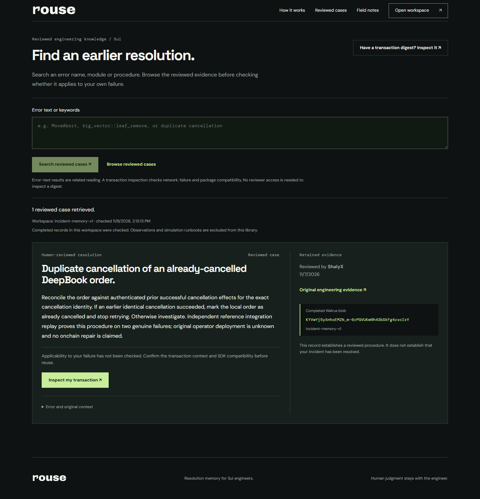

# Rouse

Resolution memory for Sui engineers. Inspect a transaction, compare an earlier human-reviewed procedure, and keep its evidence available for a compatible failure.

[Open Rouse](https://casewake.vercel.app) · [Browse reviewed cases](https://casewake.vercel.app/cases) · [Read the evidence](PROOF.md)



## Use it

1. Inspect your Sui Mainnet transaction digest. No reviewer key is needed. Rouse distinguishes failed, successful and unknown outcomes from unavailable reads.
2. Compare recalled procedures, matching reasons, reviewer, evidence, SDK uncertainty and exact Walrus blob.
3. Search error text, a module or a procedure in **Reviewed cases**. Search results are related reading; inspect your transaction to check compatibility.
4. Recording requires an operator-issued reviewer key, case-specific evidence and explicit human causal review. An accepted storage job stays pending until a completed receipt is returned.
5. After reload, saved receipt metadata requires a protected check of the original job before completion or recurrence can be claimed. Uncertain writes must not be resubmitted.

Tatum provides read-only chain evidence. Walrus Memory retains the reviewed procedure. The engineer decides what to reuse. Rouse does not sign wallet transactions, execute repairs or move funds.

## Run locally

Use Node.js 24 and pnpm 10. Copy `web/.env.example` to `web/.env.local` and supply server credentials privately. The local file is ignored by Git.

```powershell
cd web
pnpm install --frozen-lockfile
pnpm build --webpack
pnpm start --hostname 127.0.0.1 --port 4242
```

Open `http://127.0.0.1:4242`. Use `pnpm dev` for development. The webpack build is the verified production build on Windows and CI.

|Variable|Purpose|
|---|---|
|`TATUM_API_KEY`|Server-side Sui Mainnet gRPC reads|
|`MEMWAL_PRIVATE_KEY`|Private delegate key for the operator's Walrus Memory account|
|`MEMWAL_ACCOUNT_ID`|Account matching that delegate|
|`MEMWAL_SERVER_URL`|Mainnet relayer endpoint supplied in the template|
|`MEMWAL_NAMESPACE`|Shared namespace; defaults to `incident-memory-v1`|
|`WORKSPACE_WRITE_KEY`|Random private reviewer token; absent disables recording|

Inspection can work with Tatum alone. Recall and discovery need the configured Walrus account. A new account does not inherit the public application's records. Configuration presence does not prove connectivity; missing configuration, unavailable reads and incomplete inventories are shown explicitly.

## Verify

From `web`, run `pnpm test`, `pnpm lint` and `pnpm build --webpack`. Tests cover compatibility, chronology, evidence validation, credential rejection, paged inventory, request uncertainty, receipts and discovery.

From the repository root, run `node web/scripts/replay-reviewed-case.mjs` to replay recorded history without network access or writes. Run `node web/scripts/check-public.mjs` for bounded anonymous reads and rejected recording requests. Set `ROUSE_BASE_URL` to check another deployment.

Do not use Mainnet recording as an installation or smoke test. Recording consumes quota and requires authorized human review. Sponsor credentials stay on the server; the reviewer token stays in page memory. This is one operator-managed namespace, not a multitenant account service. Credential-pattern rejection is not exhaustive data-loss prevention.

## Evidence and limits

The reviewed example is a duplicate DeepBook order cancellation. The reference procedure reconciles an earlier authenticated cancellation and stops duplicate retries. It was reviewed by ShalyX and replayed against genuine recorded failures. Original operator code changes/deployment remain unknown. No historical onchain repair is claimed.

[Case report](evidence/real-case/REVIEW.md) · [Completed receipt](evidence/real-case/reviewed-memory-receipt.json) · [Exact-blob recall](evidence/real-case/exact-blob-recall.json)

The November 9 snapshot contains 13 completed memories of all types, including one reviewed resolution. Observations and simulation runbooks remain separate tiers. This is not 13 verified fixes, measured time savings or customer traction. External engineer utility has not been established.

The repository address, stored schemas and older evidence use the former Casewake name for compatibility and provenance. Current product branding is Rouse. Historical article screenshots are dated and labelled. See [third-party asset notices](NOTICE.md). No submission, award or organizer endorsement is claimed here.
